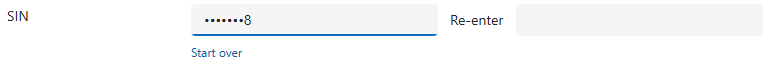
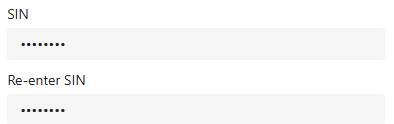

# Changelog

## Unreleased

- **An entry typed only once is flagged when focus leaves the control, and the form will not save until it is fixed.**
  "Re-enter the value to confirm." under the empty second field, or "Enter the value here first." under the empty
  first one; a SIN shorter than nine digits is flagged then too. Every error the control shows is also set on the form
  as a notification on the control, so the record cannot be saved, by button or by Ctrl+S, while it stands.
  
- **A SIN shorter than nine digits is no longer stored when typed twice: all nine digits and the checksum are required.**
  The check before writing was as lenient as the one while typing.
- **A cell made two columns wide now lays its two fields out like two stock cells on that row.**
  In a two-column section with labels on the left, the first input is the width of the stock input in the first
  column, "Re-enter" starts where that column's labels start and takes the section's label width, and the second
  input is the width of the stock input there. The control measures the neighbouring cells, so any label width works.
  
- The form is told through the page's `Xrm.Page` client API, the only route from a control to its form; where there is
  none (the test harness, a custom page) the errors show and nothing else happens.
- e2e: 47 harness tests. Eight new ones cover leaving the control with one entry, the short SIN, the two-column cell,
  and, with a stand-in form API, that the notification is set and cleared as the error comes and goes and stands
  before Ctrl+S reaches the form. The fixture form gains a two-column section with a stock row and three spanning
  cells; the real-form run fails when the control's boxes stray from the stock cells' by more than 2px, and makes the
  record dirty with an unfinished entry, where the form's own save() must reject.

## 0.4.0 - 2026-09-09

- **Sealed Input makes a person type a sensitive number twice, masking every character and blocking the clipboard.**
  Field control for `SingleLine.Text` columns on model-driven app forms. The character just typed stays readable for a
  second, then turns into a dot; paste, drop, cut, autofill and password managers are all shut off at the field.
  
- **The column is written only once both entries agree and pass validation, so a half-typed number never reaches Dataverse.**
  Digits only by default, optionally checked as a Canadian SIN (nine digits, Luhn), with a length cap for everything else.
  A stored value shows a fixed eight dots, which say nothing about how long the real one is.
- **The two fields borrow the form's own label placement, side by side in a wide cell and stacked in a narrow one.**
  The control reads the section's label column out of the DOM, so its inputs line up with the stock fields beside them.
  Nothing about labels is configurable: the form decides, and the fields are named after the column.
  
- **The control is five files in one folder, so it can be dropped into another solution with `npx degit`.**
  `sealedInput.ts` holds the rules with no React or DOM in them, which is the file to edit for another country's
  checksum or a different character filter. See [VENDORING.md](VENDORING.md).
- Ships as one solution, managed and unmanaged, plus a source zip for vendoring.
- The vendoring steps were run end to end before release: a clean `pac pcf init` produces scaffolding identical to
  this repo's, and the five files plus the Fluent pin build on their own.
- e2e: 39 Playwright tests against the pcf-start harness cover masking and reveal timing, every blocked input path,
  mismatch, match and store, and the SIN checksum; a second run builds a fixture form in a Dataverse environment,
  types a SIN through the real control, saves it and reads the column back.
- Limitation kept as a decision: a half-finished entry cannot block the form's save, because standard controls have
  no field notification API. Protecting the column itself is Dataverse column security's job.
