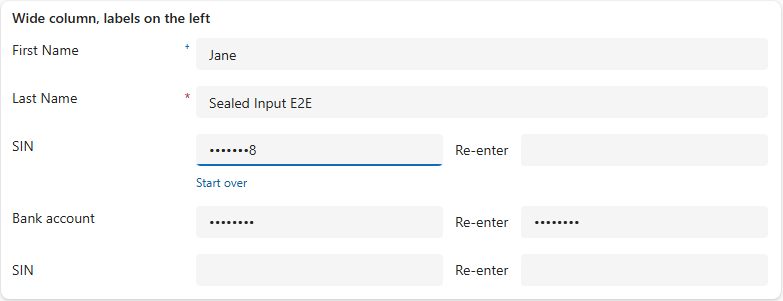

# xrm-sealed-input

A model-driven app field control for typing a sensitive number by hand: no
paste, every earlier character masked, and the value entered twice before it
is stored. Made for bank account numbers and Social Insurance Numbers.



**[How to use it](docs/usage.md)**: adding it to a form, its configuration,
and every interaction rule, with screenshots.

## Install

Import `xrm-sealed-input-<version>-managed.zip` (or the unmanaged zip) from a
[release](https://github.com/comentality/xrm-sealed-input/releases), then add
Sealed Input to a text column on a form.

The control governs how a value is typed, not how it is stored. Protect the
column itself with Dataverse column security.

## Vendor it

The control is five files in one folder. Copy them into your own solution:

```
npx degit comentality/xrm-sealed-input/SealedInput/SealedInput   SealedInput/SealedInput
```

[VENDORING.md](VENDORING.md) says what each file is, how to build a project
around them, and what to change to make the rules your own.

## Licence

Public domain, under the [CC0 1.0 Universal](LICENSE) dedication. No
attribution required, no notice to carry.

## Repository

- `SealedInput/`: the PCF (`KK.SealedInput`, React 16 + Fluent 9.46.2).
- `solution/`: packaging; `dotnet build -c Release` there makes the solution zip.
- `e2e/`: Playwright tests against the PCF test harness (`npx playwright test`),
  plus `run.mjs`, which puts the control on a real form in a Dataverse
  environment and screenshots it.
- `docs/usage.md`: the manual. `docs/notes.md`: the brief, the design
  decisions and the gotchas met while building it.
