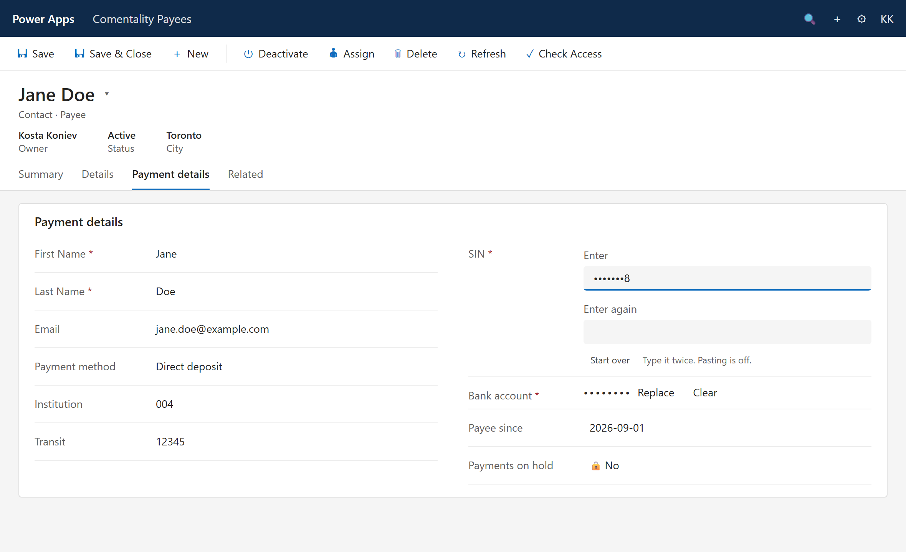
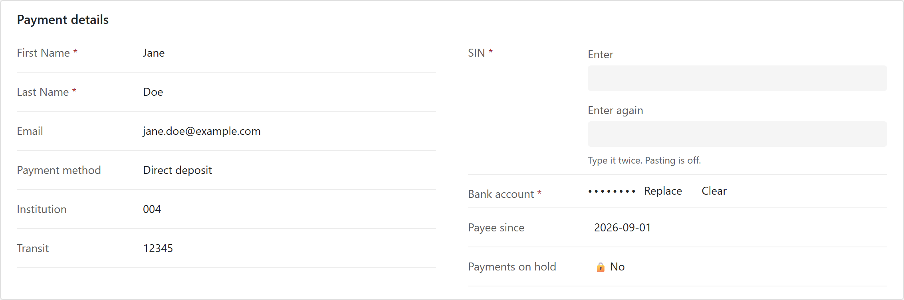
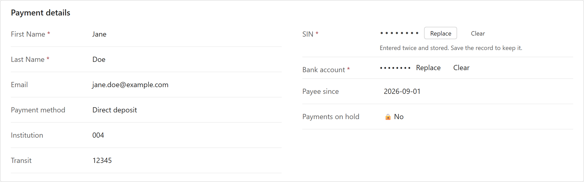

# Sealed Input: how to use it

A field control for model-driven apps that makes a person type a sensitive
number by hand. Nothing can be pasted or dropped into it, every character
turns into a dot as soon as the next one is typed, and the value is only
stored once it has been entered twice the same way. Made for bank account
numbers and Social Insurance Numbers.

## On a form

A mock-up of a Contact form with the control on two columns: SIN mid-entry,
bank account already stored. The control is the real build driven with real
keystrokes; the form around it is static HTML laid out like a model-driven
app. It is not a screenshot of Dataverse.



| Empty, waiting for entry | Both stored |
|---|---|
|  |  |

Rebuild it with `npm run mock` in `e2e/`.

## What the user sees

The column starts empty. Two fields, one hint.


While typing, the character just typed stays readable for a second, then
becomes a dot. Everything before it is already a dot. Leaving the field
masks the last character at once.

| Typing `1234` | After a moment, or on leaving the field |
|---|---|
|  |  |

Enter, or Tab, moves to the second field. When the second entry is as long as
the first and differs, the control says so. Nothing is stored. Backspace and
retype, or **Start over** to clear both fields.


The moment both entries agree the value is written to the column and the
control collapses to a row of dots. The row is always eight dots, whatever the
length of the value, so the stored view gives nothing away. Save the record as
usual.


Opening a record that already has a value shows the same row of dots. The
value itself is never rendered. **Replace** opens the two fields again;
**Cancel** goes back without changing anything. **Clear** empties the column.

| Existing value | After Replace |
|---|---|
|  |  |

With SIN validation on, a nine-digit entry that fails the checksum is flagged
under the first field, before the person types it a second time.


When the form is read-only the control shows eight dots, or a dash when the
column is empty, and nothing else.

## Configuration

Set these in the form designer when adding the control to the column. All are
optional.

| Property | Default | What it does |
|---|---|---|
| Characters | Digits only | `Digits only` drops anything that is not 0 to 9. `Any character` accepts whatever is typed. |
| Validation | None | `Canadian SIN` requires nine digits with a valid Luhn checksum and caps typing at nine. |
| Maximum length | 0 | Longest value that can be typed. 0 means no limit. Ignored when validation is SIN. |
| Reveal last character (ms) | 1000 | How long the character just typed stays readable. 0 masks at once. |

Suggested settings:

- **Bank account number**: Characters `Digits only`, Maximum length 12.
- **SIN**: Validation `Canadian SIN`. The length follows.

## 1. Get it into your environment

Import the solution zip from a release, or build and push from source:

```powershell
cd SealedInput
npm install
pac auth create --environment https://<your-org>.crm.dynamics.com
pac pcf push --publisher-prefix <your-prefix>
```

After the push the control appears in the environment as
`<prefix>_KK.SealedInput`.

## 2. Put it on a form column

1. The column must be **Single line of text**. Give it a maximum length that
   fits the values you expect (a SIN is 9 characters).
2. Open the form in the form designer (make.powerapps.com, Tables, your table,
   Forms) and select the column on the form.
3. In the properties pane on the right, expand **Components** and choose
   **Get more components**.
4. Pick **Sealed Input**, add it, and set the properties above.
5. Make it the only control for the column on web, tablet and phone, or the
   stock text box will show the value in clear on the other form factors.
6. Save and publish the form.

## What this control does not do

Be clear about this with whoever asked for it.

- **It hides the value on this form only.** The column is still ordinary text
  in Dataverse. Views, Advanced Find, exports, the Web API and any other form
  show it in clear to anyone with read access. To protect the data itself, use
  Dataverse column security profiles (and masking rules where available) on the
  column. This control is the entry discipline; column security is the lock.
- **The clipboard block is a courtesy, not a guarantee.** It stops the everyday
  paste, drop and autofill paths. A determined person with developer tools can
  put anything into any field.
- **A half-finished entry does not block saving.** If the person types the
  value once and saves, the column keeps its previous value (or stays empty).
  Standard controls cannot raise a form notification for that. If the value is
  mandatory, mark the column required so the form insists on it.
- **The length of a value is visible while it is typed**, one dot per
  character. Only the stored view is fixed-width.
- **Android keyboards that compose text** (swipe and predictive input) may
  not be fully intercepted. The numeric keypad that digits-only mode requests
  behaves correctly; if that proves insufficient, ask users to type digits on
  the keypad.
- **Read-only rendering is untested** in the local harness, which has no
  disabled switch. It is a plain text node with no interaction, so the risk is
  cosmetic.

## Build from source

```powershell
cd SealedInput
npm install
npm run build          # out/controls/SealedInput
npm start              # PCF test harness in a browser
```

The harness seeds the bound value with `val`, so the control opens in its
stored view. Blank the value in the property panel to see the entry fields.

## Tests

`e2e/` holds a Playwright Test suite that hosts the harness headlessly and
drives the control with real keystrokes: masking and reveal timing, Backspace,
Enter, the digit filter, the length cap, Ctrl+V and dispatched paste, drop,
cut, copy and context-menu events, mismatch, match and store, Replace, Cancel,
Clear, and the SIN checksum. It also takes the screenshots on this page.

```powershell
cd SealedInput && npm run build
cd ..\e2e
npm install
npx playwright test    # starts the harness on port 8183 itself
npm run docs           # copies the screenshots into docs/img
```
