# Sealed Input: how to use it

A field control for model-driven apps that makes a person type a sensitive
number by hand, twice. Nothing can be pasted or dropped into it, every
character turns into a dot as soon as the next one is typed, and the column
only changes once both entries agree. Made for bank account numbers and Social
Insurance Numbers.

## On a form

A Contact form in a model-driven app. The wide column has the control on SIN
and on bank account, and once more with the cell label hidden; the narrow
column shows the SIN column again. The form draws the column label itself, so
the control only labels its second field, "Re-enter", and puts that label
where the section puts labels: beside the field in the wide column, whose
section has labels on the left, and above it in the narrow column, whose
section has labels on top. Where the cell label is hidden, nothing else names
the column, so both fields are labelled. The control measures the cell it is
given: from 480 pixels up the two fields share one line; below that they stack.

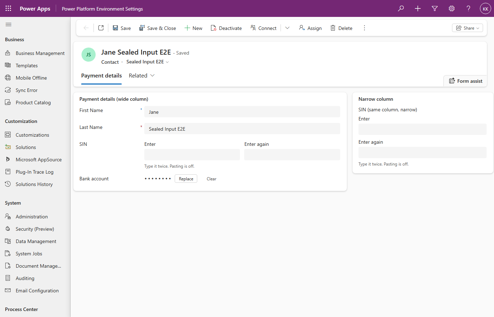

Typing the SIN in the wide column. The bank account, already stored, shows a
fixed row of dots in both of its fields.

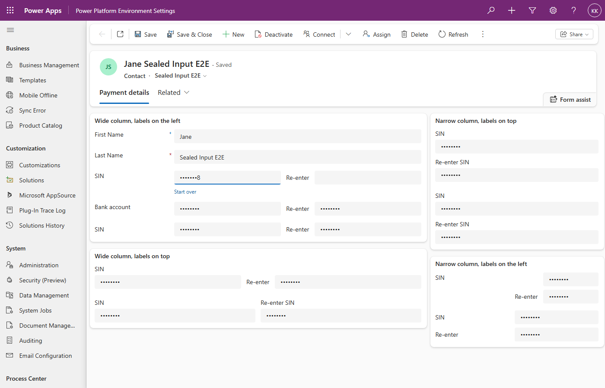

After the second entry matched. Every field shows dots only, and the form is
marked unsaved until the record is saved.

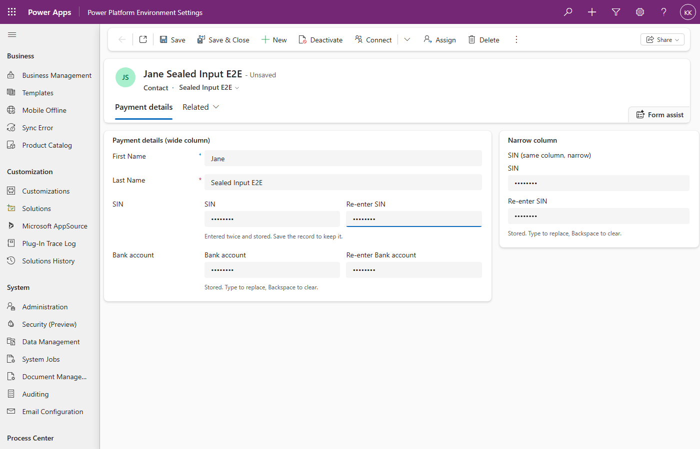

These are real screenshots taken by `e2e/run.mjs` in a test environment: it
builds the fixture form, types the SIN twice, saves with Ctrl+S and reads the
column back through the Web API to confirm it holds exactly what was typed.
`npm run mock` produces a similar picture without an environment.

## What the user sees

Always two fields. An empty column shows them empty. There is no hint text;
the labels say what to do.

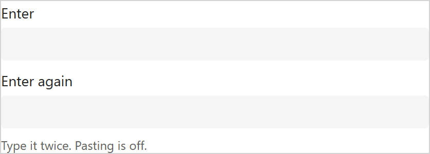

While typing, the character just typed stays readable for a second, then
becomes a dot. Everything before it is already a dot. Leaving the field
masks the last character at once.

| Typing `1234` | After a moment, or on leaving the field |
|---|---|
| 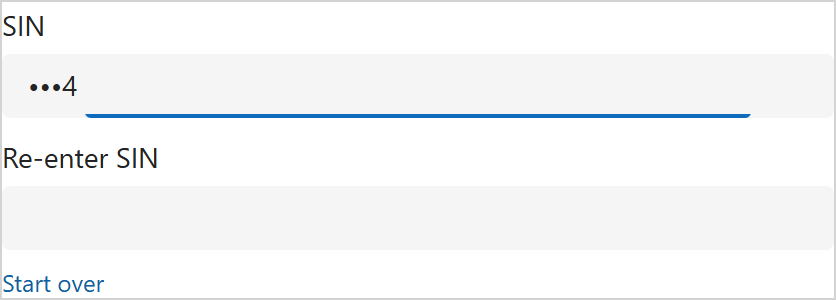 | 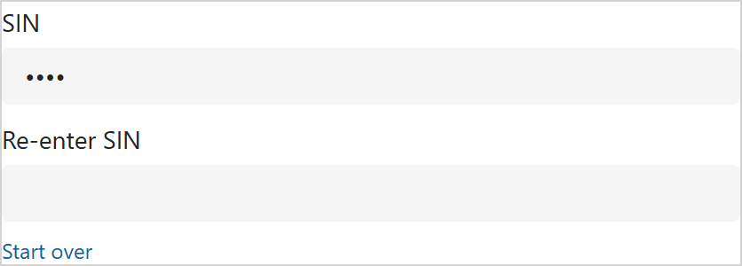 |

In a wide cell the two fields share one line. The layout follows the width of
the cell, so the same control stacks on a phone or in a narrow section.

| Narrow cell | Wide cell |
|---|---|
| 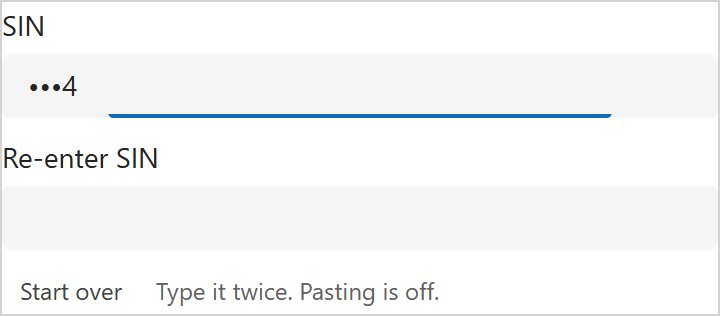 | 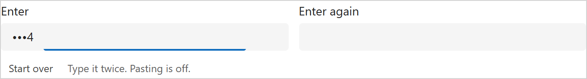 |

Enter, or Tab, moves to the second field. Coming back into a field that
already holds an entry selects the entry, and from then on only retyping is
possible: the next keystroke replaces it, Backspace clears it, and no part of
it can be removed. When the second entry is as long as the first and differs,
the control says so under the second field; leaving either field compares
the entries at once, a shorter second entry included. Nothing is stored
until they agree. Retype, or **Start over**, a small link under the fields
while an entry is in progress, to clear both.

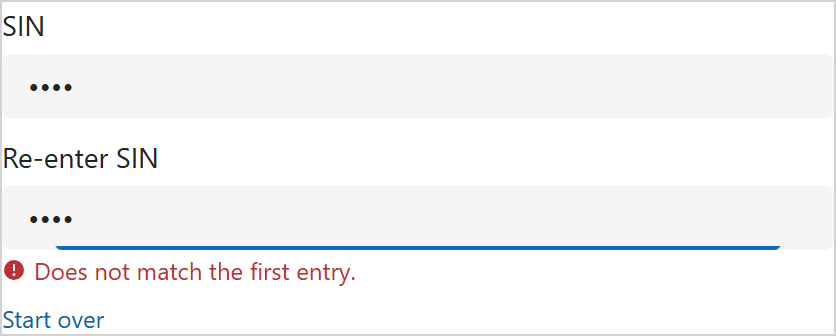

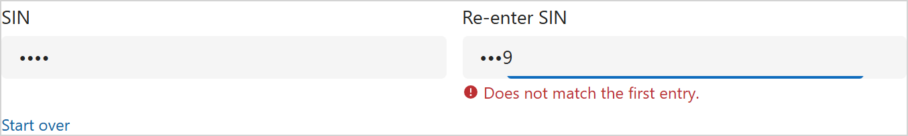

Leaving the control with only one of the two entries typed flags the empty
field: "Re-enter the value to confirm." under the second, or "Enter the value
here first." under the first. With SIN validation on, a first entry shorter
than nine digits is flagged then too. Every error the control shows is also
set on the form as a notification on this control, so the form marks it
invalid and will not save the record until the entry is fixed, finished, or
started over. Ctrl+S with an unfinished entry sets that mark before the save
runs.

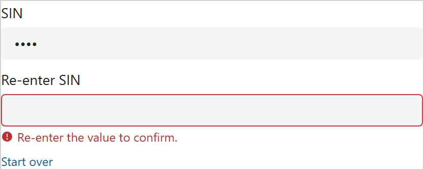

Once both entries agree the value is ready. It is written to the column when
focus leaves the control, and at that same moment both fields switch to a
fixed row of eight dots, whatever the length of the value, so a stored value
gives nothing away. Until then the typed dots stay. If the same column is on
the form more than once, every copy refreshes together. Save the record as
usual; Ctrl+S with focus still in the field writes the value first.

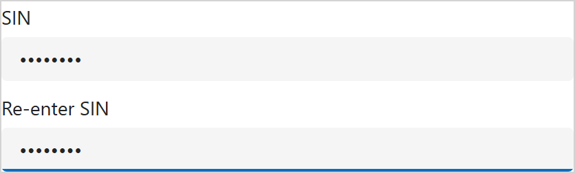

Opening a record that already has a value shows the same two rows of dots. The
value itself is never rendered. To **replace** it, click into either field and
type: both fields clear and a fresh entry begins. To **clear** it, click into a
field and press Backspace: both fields empty, and the column is cleared when
focus leaves the control. **Start over** during a replacement goes back to the
stored dots without changing anything.

| Existing value | After the first keystroke |
|---|---|
| 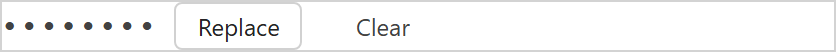 | 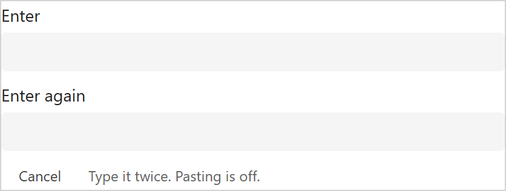 |

With SIN validation on, a nine-digit entry that fails the checksum is flagged
under the first field, before the person types it a second time.

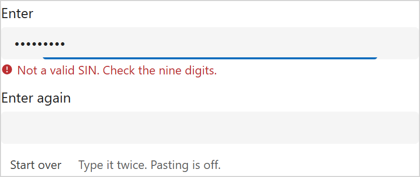

When the form is read-only both fields are disabled and show eight dots, or
nothing when the column is empty.

Inside a form cell the labels follow the form. With the cell label shown on
the left, only "Re-enter" appears, beside the second field. With the cell
label on top, "Re-enter SIN" appears above the second field when the fields
stack; when they share a line, "Re-enter" goes beside the second input so
the two inputs stay on that line. With the cell label hidden, both fields
are labelled, placed like the neighbouring cells, and the first label takes
the section's own label column so the first input lines up with the stock
fields around it. Side by side, the two inputs come out the same width. The
fields are always named after the column's display name; there is no
setting for the wording, which labels go, or where they sit.

| Cell label on the left | Cell label on top, fields stacked | Cell label on top, fields side by side |
|---|---|---|
| 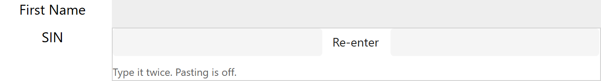 | 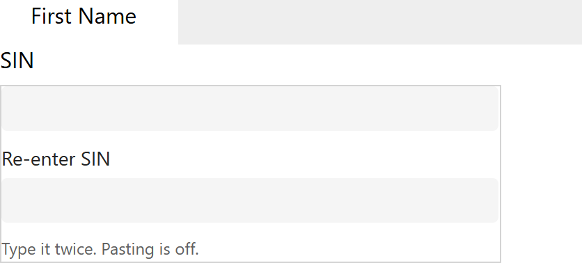 | 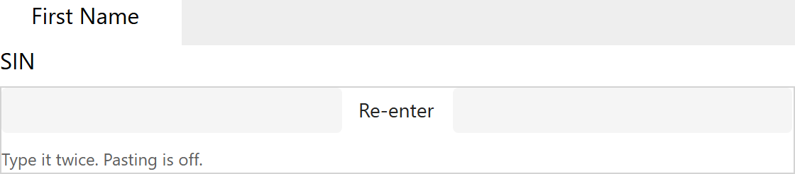 |

| Cell label hidden | Cell label hidden, wide label column in a narrow cell |
|---|---|
| 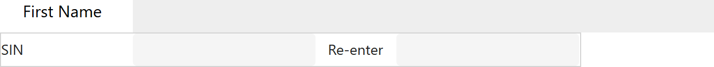 | 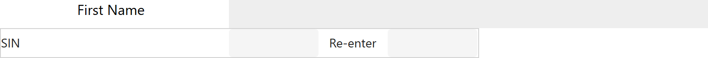 |

In a section with two columns and labels on the left, a cell made two
columns wide lays its fields out like two stock cells on that row: the first
input is the width of the stock input in the first column, "Re-enter" starts
where the second column's labels start and takes that column's label width,
and the second input is the width of the stock input there. The control
measures the neighbouring cells for this, so it holds for whatever label
width the section has. A hidden cell label puts the first label in the first
column's label column the same way.

| Cell spanning two columns, above a row of two stock cells | The same with the cell label hidden |
|---|---|
|  | 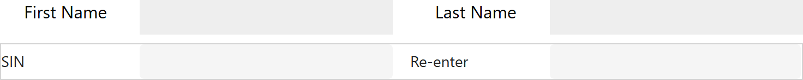 |

## Interaction rules

The rules the control follows, kept as one list. Each has a harness test.

- **Two fields, always.** The column's name and "Re-enter" it. Enter or Tab
  moves from the first to the second. Labels follow the form, see above.
- **Typing.** The character just typed stays readable for the reveal time
  (one second by default), then becomes a dot; everything before it is a dot.
  Leaving the field masks the last character at once. Only allowed characters
  are taken (digits by default); the rest are dropped. Backspace while typing
  removes the last character.
- **Nothing gets in from outside.** Paste, drop, cut, copy, the context menu,
  autofill and password managers are blocked on both fields.
- **Coming back to a field.** Focusing a field that holds an entry, by mouse
  or keyboard, selects the whole entry. From then on only retyping is
  possible: any character replaces the entry, Backspace or Delete clears it,
  the caret cannot be moved into it, clicks and shift-selection keep it whole.
  An entry is never added to after leaving the field.
- **Comparison while typing.** As soon as the second entry is as long as the
  first and differs, "Does not match the first entry." appears under the
  second field. It goes away the moment they agree.
- **Comparison on leaving a field.** Leaving either field compares the
  entries at once; a second entry that is shorter than the first is flagged
  too. An empty second entry is not flagged yet. The next edit makes it
  quiet again until it is long enough or focus leaves again.
- **Leaving the control.** Focus going outside the control (moving between
  the two fields does not count) flags an entry made only once, on the empty
  field: "Re-enter the value to confirm." under the second, "Enter the value
  here first." under the first. A SIN shorter than nine digits is flagged
  then as well. The flag stays through a return to the field and goes with
  the next keystroke or Start over.
- **The form is told.** Any error the control shows is set on the form as a
  notification on this control, and cleared when the error goes, so the form
  marks the control invalid and refuses to save while it stands. Ctrl+S or
  Cmd+S with an unfinished entry counts as leaving the control: the flag and
  the notification are set before the form's save runs. This goes through the
  form's own client API on the page; where there is none (the test harness,
  a custom page) the errors show and nothing else happens.
- **Storing.** Once both entries agree and pass validation the value is
  ready. It is written to the column when focus leaves the control (moving
  between the two fields does not count), and both fields switch to a fixed
  row of eight dots at that same moment, so other copies of the column on the
  form refresh together with this one. The typed dots stay until then.
  Ctrl+S or Cmd+S with focus still in a field writes the value before the
  form saves. An edit before focus leaves makes the entry a fresh one; nothing
  is written.
- **A stored value.** Both fields show eight dots, whatever the length; the
  value is never rendered. Focusing a field selects the dots. Typing starts a
  fresh entry in that field and empties the other; Backspace over the dots
  empties both fields, and the column is cleared when focus leaves the
  control.
- **Start over.** A small link under the fields while an entry is in
  progress. It discards both entries: back to the stored dots, or to empty
  fields.
- **Validation.** Canadian SIN: nine digits with a valid checksum; the error
  shows under the first field once nine digits are in, or when focus leaves
  the control with fewer; typing stops at nine, and nothing is stored until
  it passes, however many times it is typed. Maximum length caps typing.
- **Read-only.** Both fields disabled, showing the dots or nothing.
- **No hint text.** The labels and the errors are all the control says.

## Configuration

Set these in the form designer when adding the control to the column. All are
optional.

| Property | Default | What it does |
|---|---|---|
| Characters | Digits only | `Digits only` drops anything that is not 0 to 9. `Any character` accepts whatever is typed. |
| Validation | None | `Canadian SIN` requires nine digits with a valid Luhn checksum and caps typing at nine. |
| Maximum length | 0 | Longest value that can be typed. 0 means no limit. Ignored when validation is SIN. |
| Reveal last character (ms) | 1000 | How long the character just typed stays readable. 0 masks at once. |
| Layout | Auto by width | `Auto` puts the two fields side by side from 480 pixels of width and stacks them below that. `Stacked` and `Side by side` force one or the other. |

Suggested settings:

- **Bank account number**: Characters `Digits only`, Maximum length 12.
- **SIN**: Validation `Canadian SIN`. The length follows.

## 1. Get it into your environment

Import the solution zip from a release, or build and push from source:

```powershell
cd SealedInput
npm install
pac auth create --environment https://<your-org>.crm.dynamics.com
pac pcf push --publisher-prefix <your-prefix>
```

After the push the control appears in the environment as
`<prefix>_KK.SealedInput`.

## 2. Put it on a form column

1. The column must be **Single line of text**. Give it a maximum length that
   fits the values you expect (a SIN is 9 characters).
2. Open the form in the form designer (make.powerapps.com, Tables, your table,
   Forms) and select the column on the form.
3. In the properties pane on the right, expand **Components** and choose
   **Get more components**.
4. Pick **Sealed Input**, add it, and set the properties above.
5. Make it the only control for the column on web, tablet and phone, or the
   stock text box will show the value in clear on the other form factors.
6. Save and publish the form.

## What this control does not do

Be clear about this with whoever asked for it.

- **It hides the value on this form only.** The column is still ordinary text
  in Dataverse. Views, Advanced Find, exports, the Web API and any other form
  show it in clear to anyone with read access. To protect the data itself, use
  Dataverse column security profiles (and masking rules where available) on the
  column. This control is the entry discipline; column security is the lock.
- **The clipboard block is a courtesy, not a guarantee.** It stops the everyday
  paste, drop and autofill paths. A determined person with developer tools can
  put anything into any field.
- **The save block needs a model-driven form.** The control marks itself
  invalid through the form's client API (`Xrm.Page`, the page global), which
  the control framework does not offer and custom pages do not have. Where it
  is missing, the errors still show under the fields, but an entry typed once
  does not stop a save: the column keeps its previous value. An empty column
  never blocks anything; if the value is mandatory, mark the column required.
- **The length of a value is visible while it is typed**, one dot per
  character. Only the stored view is fixed-width.
- **Android keyboards that compose text** (swipe and predictive input) may
  not be fully intercepted. The numeric keypad that digits-only mode requests
  behaves correctly; if that proves insufficient, ask users to type digits on
  the keypad.
- **Read-only rendering is untested** in the local harness, which has no
  disabled switch. It is a plain text node with no interaction, so the risk is
  cosmetic.
- **The labels read the page, not an API.** Nothing in the control framework
  says whether the form shows the cell label or where the section puts it, so
  the control looks at the DOM around it the way Unified Interface renders a
  cell today. If that changes, the control falls back to labelling both
  fields, above. There is no property to correct it by hand; a fix means a new
  version of the control.

## Build from source

```powershell
cd SealedInput
npm install
npm run build          # out/controls/SealedInput
npm start              # PCF test harness in a browser
```

The harness seeds the bound value with `val`, so the control opens in its
stored view. Blank the value in the property panel to see the entry fields.

## Tests

`e2e/` holds a Playwright Test suite that hosts the harness headlessly and
drives the control with real keystrokes: masking and reveal timing, Backspace,
Enter, the digit filter, the length cap, Ctrl+V and dispatched paste, drop,
cut, copy and context-menu events, mismatch, match and store, an entry made
once, replacing and clearing a stored value, the SIN checksum, narrow and wide
layout, and what a stand-in form API is told and when. It also takes the
screenshots on this page.

```powershell
cd SealedInput && npm run build
cd ..\e2e
npm install
npx playwright test    # starts the harness on port 8183 itself
npm run docs           # copies the screenshots into docs/img
```

Against a real environment, after `pac pcf push` (the run goes to the environment
of the active `pac auth` profile, or to `ORG_URL` when that is set):

```powershell
node run.mjs --login   # first time: sign in in the window that opens
node run.mjs           # afterwards: headless, reuses the saved profile
```

`run.mjs` creates two text columns on Contact (`cmtl_sin`, `cmtl_bankaccount`),
a Contact main form "Sealed Input E2E", and a contact "Jane Sealed Input E2E",
then screenshots the form, types a SIN once and tries to save (the column must
stay as it was), then types it twice, saves and reads the column back.
All fixtures are ordinary customisations and can be deleted afterwards.
